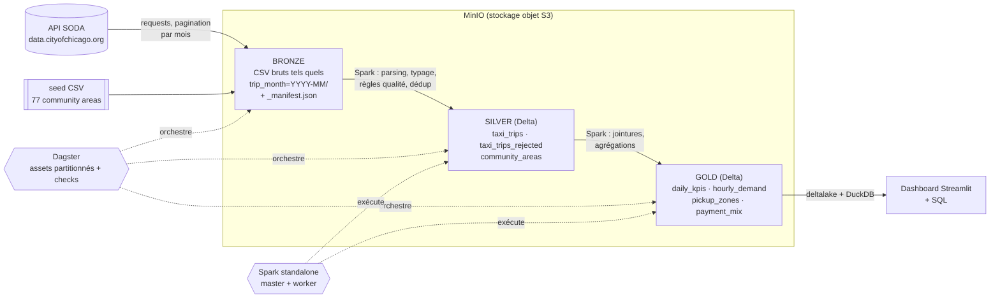

# Chicago Taxi Datalake — pipeline médaillon (Dagster · PySpark · Delta Lake · MinIO)

Pipeline de données de bout en bout, 100 % local, qui :

1. **ingère** les trajets de taxi de Chicago depuis l'API SODA dans un datalake objet (MinIO) ;
2. **nettoie / type / déduplique / contrôle** les données avec Spark (couche *silver*, Delta Lake) ;
3. **expose** des agrégats métier prêts pour la BI (couche *gold*) via un dashboard Streamlit et du SQL (DuckDB).

Tout démarre avec `docker compose up`, puis un déclenchement (`make run` ou un clic dans Dagster).

---

## 1. Architecture



| Service (docker compose) | Rôle | URL |
|---|---|---|
| `minio` | Stockage objet S3 : un bucket par couche (`bronze`, `silver`, `gold`) | console http://localhost:9001 (minioadmin / minioadmin) |
| `init-storage` | Job one-shot qui crée les buckets | — |
| `spark-master`, `spark-worker` | Cluster Spark 3.5 standalone | http://localhost:8080 |
| `postgres` | Base de métadonnées Dagster (runs, events, historique) | — |
| `dagster-webserver` | UI Dagster (lineage, runs, data quality) | http://localhost:3000 |
| `dagster-daemon` | Exécute la file de runs, schedules et sensors ; héberge le driver Spark | Spark UI du job : http://localhost:4040 |
| `dashboard` | Couche d'exposition : Streamlit + SQL DuckDB sur la couche gold | http://localhost:8501 |

Une **seule image Docker** (Python 3.11 + Java 17 + PySpark 3.5.7 + jars s3a/Delta) sert à tous les services Python : le driver et les executors Spark ont donc toujours exactement les mêmes versions.

---

## 2. Prérequis

- Docker + Docker Compose v2 (Docker Desktop : allouer **≥ 8 Go de RAM** et 4 CPU)
- `make` (optionnel : chaque cible du Makefile est une simple commande `docker compose`)
- Un accès internet (API SODA, Docker Hub, Maven Central au build)

## 3. Lancement pas à pas

```bash
git clone <ce repo> && cd chicago-taxi-datalake

# 1. Configuration (valeurs par défaut prêtes à l'emploi)
cp .env.example .env            # optionnel : renseigner SODA_APP_TOKEN (quota API plus élevé)

# 2. Build + démarrage de la plateforme (≈ 3-5 min au premier build)
docker compose up -d --build    # ou : make up

# 3. Déclenchement du pipeline complet (référentiel → 3 mois bronze/silver → gold)
make run                        # = docker compose exec dagster-daemon bash scripts/run_pipeline.sh
```

**Alternative 100 % UI** : ouvrir http://localhost:3000 → *Assets* → *Materialize all* → sélectionner toutes les partitions → *Launch backfill*. Dagster respecte automatiquement l'ordre bronze → silver → gold.

4. Consulter les résultats :
   - Dagster http://localhost:3000 : lineage, métadonnées de chaque matérialisation (lignes brutes / valides / rejetées, doublons, taux de rejet, top 5 zones), résultats des *asset checks* ;
   - Dashboard http://localhost:8501 : KPIs, revenus par jour, durée moyenne, top zones, heatmap de la demande, onglet SQL libre ;
   - SQL en ligne de commande : `make sql` puis par ex. `SELECT * FROM daily_kpis ORDER BY revenue_total DESC LIMIT 5;`
   - Fichiers du lake : console MinIO http://localhost:9001.

**Sous Windows (PowerShell, sans `make`)** :

```powershell
copy .env.example .env
docker compose up -d --build
docker compose exec dagster-daemon bash scripts/run_pipeline.sh
```

Autres commandes : `make test` (tests unitaires dans l'image), `make logs`, `make down`, `make clean` (supprime aussi les données).

---

## 4. Données : période et téléchargement

- **Dataset** : [Taxi Trips (2013-2023)](https://data.cityofchicago.org/Transportation/Taxi-Trips-2013-2023-/wrvz-psew), id `wrvz-psew`.
- **Période retenue : T1 2023 (janvier → mars 2023)**, soit de l'ordre de 1,5 M de trajets (le nombre exact est affiché dans les métadonnées Dagster après le run). Modifiable via `PIPELINE_START_MONTH` / `PIPELINE_END_MONTH` dans `.env` (fin exclusive).
- **Téléchargement** (`pipeline/ingestion/soda.py`), un mois = une partition :

  ```
  GET https://data.cityofchicago.org/resource/wrvz-psew.csv
      ?$where=trip_start_timestamp >= '2023-01-01T00:00:00' AND trip_start_timestamp < '2023-02-01T00:00:00'
      &$order=trip_id          # ordre stable => pagination fiable
      &$limit=50000&$offset=0  # puis 50000, 100000… jusqu'à une page incomplète
  ```
  Retries avec backoff exponentiel (429/5xx), header `X-App-Token` si `SODA_APP_TOKEN` est défini.

- Le téléchargement est fait **par l'asset bronze lui-même** (le pipeline est donc reproductible de bout en bout). Pour travailler hors-ligne ou ne pas re-solliciter l'API, on peut pré-télécharger un cache local :

  ```bash
  make download   # = python -m pipeline.ingestion.soda --start-month 2023-01 --end-month 2023-04 --out /opt/data/raw
  ```
  Les fichiers arrivent dans `./data/raw/trip_month=YYYY-MM/page_XXXXX.csv` ; l'asset bronze (mode `source: auto`) les utilise en priorité.

---

## 5. Le pipeline en détail

### Bronze — données brutes (`s3://bronze/chicago_taxi_trips/trip_month=YYYY-MM/`)
- Chaque page renvoyée par l'API est stockée **sans aucune modification** (CSV, header inclus).
- Un `_manifest.json` par partition trace la source, la requête, la date d'ingestion, le nombre de lignes et le **sha256 de chaque fichier** (lineage / audit).
- Idempotence : la partition est vidée avant réécriture → relancer un mois ne crée jamais de doublon.
- Référentiel : le CSV des 77 *community areas* (versionné dans `data/reference/`) est déposé dans `s3://bronze/reference/`.

### Silver — données nettoyées (Delta, partitionnées par `trip_month`)
Transformations pures et testées dans `pipeline/transformations/silver.py` :
1. **Parsing / typage explicite** (lecture CSV 100 % string, pas d'`inferSchema`) : normalisation des noms de colonnes, timestamps multi-formats (format API et format export du portail), montants nettoyés (`$`, `,`), colonnes manquantes ajoutées à `null` (schéma stable).
2. **Règles qualité** : chaque ligne reçoit `dq_errors`, la liste des règles violées :
   `trip_id_missing`, `start_timestamp_invalid`, `start_outside_partition`, `end_before_start`, `duration_out_of_range` (0–24 h), `distance_out_of_range` (0–500 mi), `negative_fare`, `trip_total_out_of_range` (0–2 000 $).
   Les lignes invalides ne sont **pas supprimées silencieusement** : elles vont dans `silver/taxi_trips_rejected` avec leurs motifs (rejouables, analysables).
3. **Déduplication** sur `trip_id` (fenêtre, on garde la version la plus complète).
4. **Enrichissement** : `trip_date`, `pickup_hour`, `weekday`, `duration_min`, `avg_speed_mph`, `tip_rate`, `is_airport_trip` (O'Hare / Midway), `is_zero_distance`, colonnes techniques `_source_file`, `_processed_at`.
5. Écriture Delta avec `replaceWhere trip_month = 'YYYY-MM'` → **idempotent par partition**.

### Gold — tables analytiques (Delta)
| Table | Grain | Contenu |
|---|---|---|
| `daily_kpis` | jour | trajets, revenu total / course / pourboires, ticket moyen, **durée moyenne et médiane**, distance, taxis actifs, part aéroport |
| `hourly_demand` | jour de semaine × heure | trajets moyens par jour, durée et ticket moyens (heatmap) |
| `pickup_zones` | période × zone de prise en charge | **top zones** (rang, part, revenu, pourboire moyen) par mois et sur toute la période (`period = 'ALL'`), avec **jointure** sur le référentiel des community areas |
| `payment_mix` | type de paiement | trajets, part, revenu, taux de pourboire |

### Contrôles qualité (Dagster asset checks, visibles dans l'UI)
| Asset | Check | Sévérité |
|---|---|---|
| bronze_taxi_trips | partition non vide | ERROR |
| silver_taxi_trips | non vide · unicité `trip_id` · taux de rejet ≤ 10 % | ERROR · ERROR · WARN |
| gold_daily_kpis | Σ trajets gold = nb lignes silver (réconciliation) · revenus ≥ 0 | ERROR |
| gold_pickup_zones | les zones couvrent 100 % des trajets | ERROR |

### Orchestration (Dagster)
- **Software-defined assets** : le lineage bronze → silver → gold est déclaratif et visible dans l'UI.
- **Partitions mensuelles** sur bronze/silver (backfill, rejeu d'un seul mois) ; gold est recalculée sur l'ensemble de silver.
- **Jobs** : `monthly_trips_job` (partitionné), `reference_job`, `gold_job`.
- **Automatisation « prod »** (désactivée par défaut, activable en un clic) : un *schedule* mensuel sur la dernière partition et un *sensor* qui rafraîchit gold après chaque ingestion réussie.
- **QueuedRunCoordinator** avec 1 run à la fois (cf. arbitrages).

---

## 6. Choix techniques et arbitrages

| Choix | Pourquoi | Arbitrage / limite |
|---|---|---|
| **Dagster** plutôt qu'Airflow | Modèle orienté *assets* qui colle à l'architecture médaillon, partitions et backfills natifs, data quality (asset checks) et métadonnées intégrées, tests faciles | Moins répandu qu'Airflow chez certains clients ; le découpage en assets se transpose directement en DAG Airflow (1 tâche par asset) |
| **Spark standalone** (master + worker) dans compose, driver en mode client dans le daemon Dagster | Proche d'une vraie topologie cluster tout en restant léger ; `SPARK_MASTER=local[*]` suffit pour basculer en mode local | Le driver tourne dans le conteneur Dagster (mode client) : sur un vrai cluster on utiliserait `spark-submit` / Dataproc / EMR / Databricks via les intégrations Dagster |
| **Une seule image** pour tous les services Python | Supprime les incompatibilités de versions Python/Spark entre driver et executors | Image plus lourde (~1,5 Go) |
| **MinIO** + **un bucket par couche** | API S3 : le code tourne tel quel sur AWS S3 / GCS (interop) ; buckets séparés = politiques d'accès par couche | MinIO ne publie plus d'images communautaires récentes : tag figé, surchargeable via `MINIO_IMAGE` |
| **Delta Lake** en silver/gold | ACID, `replaceWhere` (réécriture idempotente d'une partition), schéma enforcé, time travel | Sur S3, Delta (LogStore par défaut) n'est sûr qu'avec **un seul writer** par table → runs sérialisés (`max_concurrent_runs: 1`). En prod : DynamoDB LogStore ou un catalogue (Unity / Glue) |
| **Bronze = CSV bruts** (pas de conversion) | Respecte « données ingérées telles quelles », permet de rejouer silver à l'identique, audit via le manifest | Pas de compression ni de schéma en bronze (volume modeste ici) |
| Ingestion en **Python (requests)** et non Spark | Appels HTTP paginés séquentiels : Spark n'apporte rien ici | Débit limité par l'API (d'où le cache local et le token optionnel) |
| **Quarantaine** des lignes invalides plutôt que suppression | Traçabilité, mesure de la qualité dans le temps | Seuils métier (24 h, 500 mi, 2 000 $) arbitraires, documentés et centralisés dans le code |
| Gold en **recalcul complet** | Simple et robuste ; quelques secondes sur un trimestre | À passer en incrémental (MERGE par jour/mois) sur plusieurs années de données |
| Exposition : **Streamlit + DuckDB** (lecture Delta via `deltalake`) | Zéro serveur supplémentaire, SQL standard, lecture directe du lake | Pas de gestion des droits ni de cache partagé (cf. améliorations) |
| Timestamps conservés en **heure locale de Chicago** | C'est la sémantique de la source (arrondie au quart d'heure) | Pas de conversion UTC ; à faire si croisement avec d'autres sources |
| Transformations = **fonctions pures** DataFrame → DataFrame | Testables unitairement avec Spark local, indépendantes de Dagster et du stockage | — |

---

## 7. Tests et CI

- `tests/` : 17 tests (pytest + Spark local) — parsing multi-formats, chaque règle qualité, dédup, enrichissement, chaque table gold, pagination SODA (API mockée), cache local, chargement des définitions Dagster et du lineage.
- `make test` les exécute dans l'image ; `.github/workflows/ci.yml` lance lint (ruff), tests et `dagster definitions validate` à chaque push.

## 8. Avec plus de temps

- **Catalogue & SQL serveur** : Hive Metastore / Unity Catalog + Trino (ou Spark Thrift) pour exposer les tables à Power BI / Superset en JDBC, avec gestion des droits.
- **Incrémental** : ingestion par watermark sur `trip_start_timestamp` (les mois récents sont révisés par la ville) et MERGE en silver/gold.
- **Data quality** plus riche : Great Expectations / Soda / dbt tests, alerting (Slack) sur échec des checks, suivi du taux de rejet dans le temps.
- **Modélisation gold** : schéma en étoile (fait trajets, dimensions date, zone, compagnie, paiement) via dbt-spark, géospatial sur les centroïdes (H3).
- **Industrialisation** : séparation code location / webserver / daemon (gRPC), run launcher Docker/K8s, Spark sur Kubernetes ou service managé, Terraform, secrets dans un vault, Delta multi-writer (DynamoDB LogStore), OPTIMIZE / Z-ORDER / VACUUM planifiés.
- **Observabilité** : métriques Spark/Dagster vers Prometheus + Grafana, freshness policies sur les assets gold.
- **API** de données (FastAPI) pour les consommateurs applicatifs.

---

## 9. Structure du repo

```
├── docker-compose.yml          # toute la plateforme
├── docker/Dockerfile           # image unique : Python 3.11, Java 17, PySpark 3.5.7, jars s3a + Delta
├── Makefile                    # up / run / download / test / sql / down / clean
├── .env.example                # configuration (période, Spark, MinIO, token SODA)
├── dagster_home/               # dagster.yaml (Postgres, file de runs) + workspace.yaml
├── pipeline/
│   ├── config.py               # paramètres (variables d'environnement)
│   ├── partitions.py           # partitions mensuelles
│   ├── definitions.py          # point d'entrée Dagster : assets, jobs, schedule, sensor
│   ├── ingestion/soda.py       # client API SODA paginé (+ CLI de téléchargement)
│   ├── transformations/        # logique Spark pure (silver.py, gold.py)
│   ├── assets/                 # bronze.py, silver.py, gold.py (assets + checks)
│   ├── resources/              # SparkResource (s3a + Delta), S3Resource (boto3)
│   ├── delta_io.py             # écritures Delta idempotentes
│   └── init_storage.py         # création des buckets
├── dashboard/                  # Streamlit + DuckDB (app.py, sql_shell.py)
├── data/reference/             # référentiel des 77 community areas
├── scripts/run_pipeline.sh     # exécution complète en CLI
└── tests/                      # pytest
```

## 10. Dépannage

- **`pull access denied` sur MinIO** : définir `MINIO_IMAGE=minio/minio:latest` (ou une autre image S3-compatible) dans `.env`.
- **HTTP 429 / lenteur de l'API SODA** : créer un app token gratuit et le mettre dans `SODA_APP_TOKEN`, ou utiliser `make download` une fois puis travailler sur le cache local.
- **Job Spark qui reste en attente (`WAITING`)** : vérifier dans http://localhost:8080 que le worker est enregistré et que `SPARK_WORKER_MEMORY` ≥ `SPARK_EXECUTOR_MEMORY` ; augmenter la RAM de Docker Desktop.
- **Mac Apple Silicon** : l'image est multi-arch (JAVA_HOME résolu dynamiquement), aucune option à ajouter.
